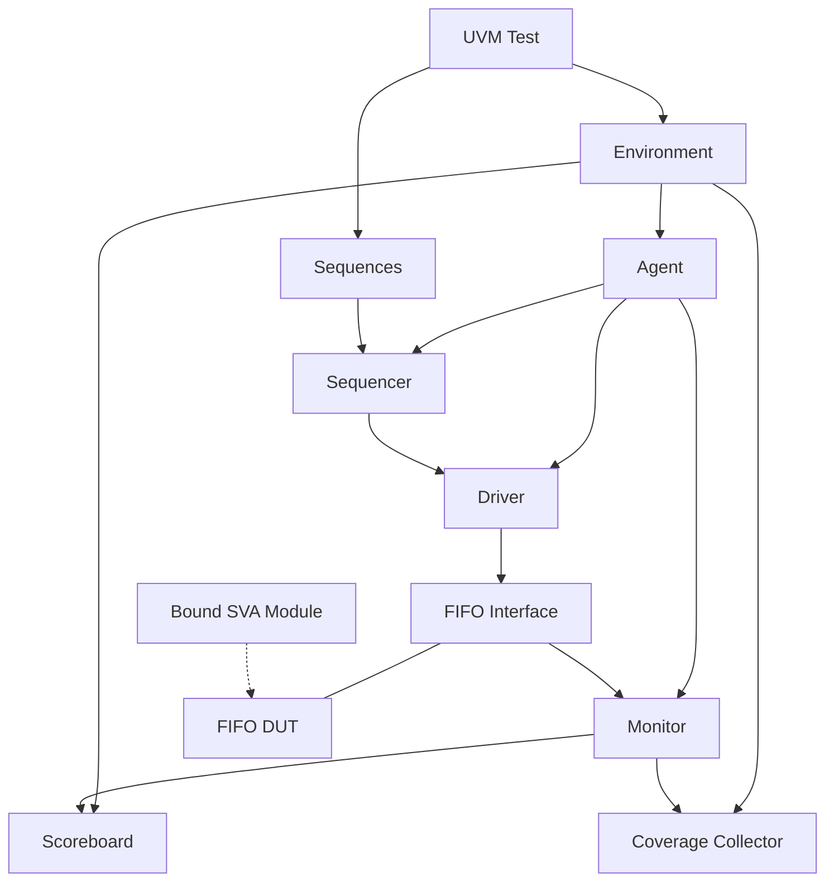

# Synchronous FIFO Verification Using UVM

### [▶ Launch the Interactive FIFO Simulator](https://ahmedjouda17.github.io/FIFO-UVM-/)

Explore FIFO read/write operations, memory contents, pointer movement,
and status flags directly in your browser.

> The interactive page illustrates FIFO behavior. The SystemVerilog/UVM
> verification environment runs separately in QuestaSim.

## Overview

This project implements a UVM verification environment for a synchronous
FIFO. It combines scenario-based stimulus, constrained randomization,
reference-model checking, SystemVerilog Assertions, and coverage collection.

The verification focuses on data ordering, reset behavior, accepted and
rejected operations, occupancy flags, pointer wraparound, and simultaneous
read/write behavior.

**Author:** Ahmed Goda Ali Sharawy  
**Supervisor:** Eng. Kareem Waseem

## FIFO Specification

| Feature | Configuration |
|---|---|
| Data width | 16 bits by default |
| FIFO depth | 8 entries by default |
| Clock | Single clock |
| Reset | Active-low asynchronous reset |
| Read output | Registered `data_out` |
| Addressing | Internal read and write pointers |
| Data ordering | First in, first out |

### Interface Signals

| Direction | Signals | Purpose |
|---|---|---|
| Input | `clk`, `rst_n` | Clock and reset |
| Input | `data_in` | Write data |
| Input | `wr_en`, `rd_en` | Write and read requests |
| Output | `data_out` | Read data |
| Output | `wr_ack` | Successful write acknowledgment |
| Output | `full`, `empty` | Occupancy boundaries |
| Output | `almostfull`, `almostempty` | One entry away from full or empty |
| Output | `overflow`, `underflow` | Rejected write or read requests |

### Simultaneous Read and Write

Operations are accepted according to the FIFO state before the active
clock edge.

| Initial FIFO state | Accepted operations | Occupancy change |
|---|---|---|
| Empty | Write only | +1 |
| Partially occupied | Read and write | No change |
| Full | Read only | −1 |

An attempted write to a full FIFO must not overwrite queued data.
An attempted read from an empty FIFO must not consume an entry.

## UVM Architecture

The environment separates stimulus generation, signal driving, monitoring,
checking, and coverage collection.



### Testbench Components

| Component | Role |
|---|---|
| Sequence item | Represents FIFO transactions and contains stimulus constraints |
| Configuration object | Carries configuration used by the UVM components |
| Sequences | Generate write-only, read-only, read/write, and idle scenarios |
| Sequencer | Supplies sequence items to the driver |
| Driver | Converts transactions into interface signal activity |
| Monitor | Observes interface activity and publishes transactions |
| Agent | Groups the sequencer, driver, and monitor |
| Scoreboard | Compares observed behavior with the reference model |
| Coverage collector | Samples transactions into covergroups and crosses |
| Environment | Instantiates and connects verification components |
| Test | Configures the environment and controls sequence execution |
| Top module | Instantiates the DUT/interface and starts the UVM test |
| Assertion module | Checks temporal and internal-state properties through binding |

### Transaction Flow

1. The test configures the environment and starts the required sequences.
2. Sequences generate transactions through the sequencer.
3. The driver applies each transaction to the FIFO interface.
4. The monitor samples the resulting activity.
5. Observed transactions are distributed to the scoreboard and coverage collector.
6. The scoreboard checks reference-model behavior while assertions check
   control and state relationships.
7. Simulation reports and coverage results are reviewed at completion.

## Verification Plan

The following matrix organizes the verification scope described in the
project report. It maps requirements to stimulus and checking methods;
it does not imply that every individual coverage bin has been closed.

| ID | Requirement | Stimulus / scenario | Checking and evidence |
|---|---|---|---|
| FIFO-01 | Reset clears pointers and occupancy | Assert active-low reset | Reset-state assertions and reset waveform |
| FIFO-02 | Reset clears `data_out` | Reset after FIFO activity | Reference-model comparison and waveform |
| FIFO-03 | Accepted writes store data in FIFO order | Write-only traffic with randomized data | Subsequent readback through scoreboard; write waveform |
| FIFO-04 | Accepted reads return the oldest queued word | Read-only traffic after writes | Reference-model scoreboard; read waveform |
| FIFO-05 | Successful writes assert `wr_ack` | Write while not full | Accepted-write acknowledgment assertion |
| FIFO-06 | Writes at full are rejected | Fill FIFO, then request another write | Overflow / no-ack assertion, pointer-hold check, and readback |
| FIFO-07 | Reads at empty are rejected | Drain FIFO, then request another read | Underflow assertion and read-pointer hold check |
| FIFO-08 | Accepted reads do not assert underflow | Read while nonempty | Accepted-read / no-underflow assertion |
| FIFO-09 | `full` matches maximum occupancy | Fill FIFO and read from full | Full-flag equivalence assertion |
| FIFO-10 | `empty` matches zero occupancy | Reset, drain, and write from empty | Empty-flag equivalence assertion |
| FIFO-11 | `almostfull` asserts at depth − 1 | Exercise occupancy around seven entries | Almost-full equivalence assertion |
| FIFO-12 | `almostempty` asserts at one entry | Exercise occupancy around one entry | Almost-empty equivalence assertion |
| FIFO-13 | Write pointer advances and wraps correctly | Repeated accepted writes across the last address | Modulo-increment assertion |
| FIFO-14 | Read pointer advances and wraps correctly | Repeated accepted reads across the last address | Modulo-increment assertion |
| FIFO-15 | Pointers hold when their operation is not accepted | Idle, blocked writes, and blocked reads | Write/read pointer-hold assertions |
| FIFO-16 | Occupancy remains within valid bounds | All traffic scenarios | Count-range assertion |
| FIFO-17 | Simultaneous accepted read/write preserves occupancy | Both enables high while partially occupied | Stable-count assertion and scoreboard |
| FIFO-18 | Simultaneous requests at empty accept only the write | Both enables high at empty | Boundary behavior checked against the reference model |
| FIFO-19 | Simultaneous requests at full accept only the read | Both enables high at full | Boundary behavior checked against the reference model |
| FIFO-20 | Idle operation preserves queued data and pointers | Both enables low | Pointer-hold assertions, waveform, and subsequent readback |

The report records execution of reset, write-only, read-only, read/write,
and idle scenarios. Individual boundary-case closure should be assessed
using the corresponding assertion and coverage evidence.

## Assertions

The assertion table in the report documents checks for:

- Reset state.
- Accepted-write acknowledgment.
- Overflow and suppressed acknowledgment for blocked writes.
- Underflow for blocked reads.
- No underflow for accepted reads.
- Full, empty, almost-full, and almost-empty flag equivalence.
- Read and write pointer increments, including wraparound.
- Pointer stability when an operation is not accepted.
- Occupancy range.
- Unchanged occupancy during simultaneous accepted read/write.

The assertion module is bound from the top-level testbench so that
verification properties can observe the relevant FIFO signals.

## Coverage Strategy

Three complementary forms of coverage are documented:

| Coverage type | Purpose | Report location |
|---|---|---|
| Code coverage | Identify exercised and unexercised RTL structures | Section 8 |
| Functional coverage | Measure scenarios represented by covergroups and crosses | Section 9 |
| Assertion / sequential-domain coverage | Assess property exercise alongside assertion results | Section 10 |

Coverage results must be interpreted together with scoreboard results,
assertion failures, and the verification plan. Passing a simulation does
not by itself establish complete coverage.

See the report screenshots for the recorded percentages and detailed results.

## Reported Simulation Results

The following results are recorded in the submitted report's verification
summary.

| Item | Reported result |
|---|---|
| Executed scenarios | Reset, write-only, read-only, read/write, idle |
| Simulation seed | `1545885009` |
| Scoreboard mismatches | 0 |
| UVM errors | 0 |
| UVM fatals | 0 |
| Assertion failures | None reported |
| Open bugs | None reported in the final summary |

All executed scenarios passed according to the report summary.

These are results from the documented run, not a new regression performed
while preparing this README. The summary's coverage-gap field remains a
placeholder, so complete coverage closure is not claimed here.

## RTL Corrections Documented

The bug-report section records changes concerning:

| Area | Documented correction |
|---|---|
| Output reset | Reset `data_out` to zero |
| Underflow | Implement a registered underflow indicator and clear it otherwise |
| Simultaneous operations | Handle the `wr_en = 1`, `rd_en = 1` case explicitly |

These changes address output initialization, rejection-flag timing, and
simultaneous-operation handling.

## Running the UVM Simulation

### Requirements

- QuestaSim with SystemVerilog and UVM support.
- The project's RTL and testbench source files.
- The supplied simulation `.do` script.

### Procedure

1. Open QuestaSim in the directory expected by the project's run script.
2. Execute the supplied `.do` script.
3. Inspect the UVM report summary and scoreboard results.
4. Review the waveforms for each sequence.
5. Review code, functional, and assertion coverage.

From the QuestaSim Transcript, use:

```tcl
do <path-to-project-script.do>
```

Replace the placeholder with the actual script path in the repository.
The script contains the project-specific compilation and simulation setup.

## Project Documentation

- `UVM Project.pdf` — assignment requirements.
- `Ahmed_goda_ali_sharawy_UVM_project.pdf` — architecture, verification
  plan, source-code screenshots, assertions, waveforms, coverage, bug
  report, and final verification summary.

## Skills Demonstrated

SystemVerilog · UVM · Constrained-Random Verification · Sequence Design ·
Virtual Interfaces · Reference Models · Scoreboards · Functional Coverage ·
SystemVerilog Assertions · Assertion Binding · QuestaSim
